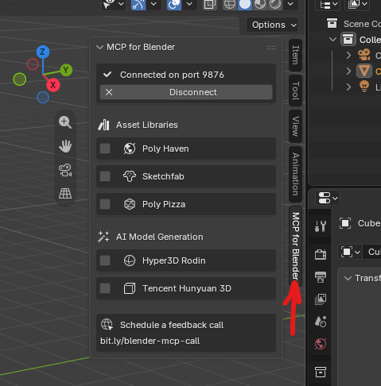

# Blender MCP + Claude / Codex + Unity · Godot · Unreal

**[Русский](#русский) · [English](#english)**

PDF: [Русская версия](docs/blender-mcp/Blender_MCP_Guide_RU.pdf) · [English version](docs/blender-mcp/Blender_MCP_Guide_EN.pdf)

---

## Русский

### Claude / Codex + движок + Blender MCP — короткий пошаговый гайд

Один проект, один Blender-файл, один порт.

**Что понадобится:** Blender, Claude Code или Codex, установленный [uv](https://docs.astral.sh/uv/) (он даёт команду `uvx`), и движок — Unity, Godot или Unreal Engine 5.

#### 1. Создайте проект в движке
Создайте новый проект в Unity (либо в другом движке — Godot, Unreal Engine 5). В этом гайде всё показывается на одном проекте.

#### 2. Откройте папку проекта в Claude или Codex
Откройте **корневую папку проекта** в Claude Code или Codex. Если используете VS Code — откройте эту же папку как рабочую папку проекта.

| Движок | Корневая папка проекта — та, где лежит |
|---|---|
| Unity | папки `Assets/`, `Packages/`, `ProjectSettings/` |
| Godot | файл `project.godot` |
| Unreal Engine 5 | файл `<Имя>.uproject` |

#### 3. Создайте Blender-файл внутри проекта
Откройте Blender и создайте новый файл. Сохраните его прямо внутри папки проекта, например: `Blender/main.blend`. Дальше используем только этот один файл `main.blend`.

#### 4. Установите Blender MCP и откройте вкладку MCP
Сначала установите аддон MCP for Blender. В терминале выполните:

```bash
uvx mcp-for-blender install-addon
```

Затем в Blender откройте **Edit → Preferences → Add-ons** и включите **“Interface: MCP for Blender”**.
После этого в 3D View нажмите **N** → откройте вкладку **“MCP for Blender”**.



#### 5. Укажите порт в Blender
Во вкладке MCP for Blender укажите порт. Для этого примера используем **9876**. Запустите MCP Server / убедитесь, что сервер активен.

#### 6. Подключите Blender MCP к Claude или Codex
Используйте только вариант для того клиента, в котором вы работаете.

**Claude Code — Desktop или VS Code.** Откройте терминал в папке проекта и выполните:

```bash
claude mcp add --scope local blender -- uvx mcp-for-blender --port 9876
```

Проверка подключения: `claude mcp list` или команда `/mcp` внутри Claude Code. Claude Code Desktop и Claude Code в VS Code используют эту конфигурацию проекта.

**Codex — Desktop или VS Code.** Откройте терминал и выполните:

```bash
codex mcp add blender -- uvx mcp-for-blender --port 9876
```

Проверка подключения: `codex mcp list`. Codex Desktop и расширение Codex для VS Code используют общую MCP-конфигурацию.

#### 7. Закройте движок, Blender оставьте открытым
Сохраните проект и закройте Unity (Godot / Unreal). Blender с файлом `main.blend` оставьте открытым. MCP Server в Blender должен оставаться запущенным на порту 9876.

#### 8. В первом промпте укажите движок, Blender-файл и порт
Скажите агенту, что он работает с текущим проектом движка. Укажите, что 3D-модели нужно создавать и редактировать через Blender MCP. Укажите имя Blender-файла `main.blend` и порт `9876`.

**Пример промпта:**

```text
Работай с текущим Unity-проектом.
Для создания и редактирования 3D-моделей используй Blender через MCP.
Blender-файл: Blender/main.blend
Порт Blender MCP: 9876
Все созданные модели и нужные файлы сохраняй внутри текущего проекта.
```

Для Godot или Unreal замените в первой строке «Unity-проектом» на «Godot-проектом» / «Unreal Engine 5 проектом».

#### Заметки по движкам
- **Unity** — готовые модели удобно экспортировать из Blender в `Assets/` в формате FBX или glTF; `Blender/main.blend` остаётся рабочим исходником.
- **Godot 4** — умеет импортировать `.blend` напрямую, если в *Editor Settings → FileSystem → Import → Blender* указан путь к Blender. Если не хотите, чтобы Godot импортировал рабочий файл, положите в папку `Blender/` пустой файл `.gdignore` и экспортируйте модели в glTF (`.glb`).
- **Unreal Engine 5** — держите `Blender/` рядом с `.uproject` (не внутри `Content/`), а в `Content/` импортируйте экспортированные FBX/glTF.

---

## English

### Claude / Codex + game engine + Blender MCP — short step-by-step guide

One project, one Blender file, one port.

**You will need:** Blender, Claude Code or Codex, [uv](https://docs.astral.sh/uv/) installed (it provides the `uvx` command), and an engine — Unity, Godot or Unreal Engine 5.

#### 1. Create a project in your engine
Create a new project in Unity (or another engine — Godot, Unreal Engine 5). This guide uses a single project for everything.

#### 2. Open the project folder in Claude or Codex
Open the **project root folder** in Claude Code or Codex. If you use VS Code, open the same folder as the workspace folder.

| Engine | The project root is the folder that contains |
|---|---|
| Unity | the `Assets/`, `Packages/`, `ProjectSettings/` folders |
| Godot | the `project.godot` file |
| Unreal Engine 5 | the `<Name>.uproject` file |

#### 3. Create a Blender file inside the project
Open Blender and create a new file. Save it directly inside the project folder, for example: `Blender/main.blend`. From now on, use only this one `main.blend` file.

#### 4. Install Blender MCP and open the MCP tab
First install the MCP for Blender add-on. In a terminal run:

```bash
uvx mcp-for-blender install-addon
```

Then in Blender open **Edit → Preferences → Add-ons** and enable **“Interface: MCP for Blender”**.
After that, press **N** in the 3D View → open the **“MCP for Blender”** tab.


#### 5. Set the port in Blender
In the MCP for Blender tab, set the port. This example uses **9876**. Start the MCP Server / make sure the server is running.

#### 6. Connect Blender MCP to Claude or Codex
Use only the option for the client you actually work in.

**Claude Code — Desktop or VS Code.** Open a terminal in the project folder and run:

```bash
claude mcp add --scope local blender -- uvx mcp-for-blender --port 9876
```

Check the connection: `claude mcp list`, or the `/mcp` command inside Claude Code. Claude Code Desktop and Claude Code in VS Code both use this project configuration.

**Codex — Desktop or VS Code.** Open a terminal and run:

```bash
codex mcp add blender -- uvx mcp-for-blender --port 9876
```

Check the connection: `codex mcp list`. Codex Desktop and the Codex extension for VS Code share the same MCP configuration.

#### 7. Close the engine, keep Blender open
Save the project and close Unity (Godot / Unreal). Keep Blender open with `main.blend`. The MCP Server in Blender must stay running on port 9876.

#### 8. In your first prompt, name the engine, the Blender file and the port
Tell the agent it is working with the current engine project. Say that 3D models must be created and edited through Blender MCP. Give the Blender file name `main.blend` and the port `9876`.

**Example prompt:**

```text
Work with the current Unity project.
Use Blender via MCP to create and edit 3D models.
Blender file: Blender/main.blend
Blender MCP port: 9876
Save all created models and required files inside the current project.
```

For Godot or Unreal, replace “Unity project” in the first line with “Godot project” / “Unreal Engine 5 project”.

#### Engine notes
- **Unity** — export finished models from Blender into `Assets/` as FBX or glTF; `Blender/main.blend` stays your working source file.
- **Godot 4** — can import `.blend` files directly if the Blender path is set in *Editor Settings → FileSystem → Import → Blender*. If you don't want Godot to import the working file, put an empty `.gdignore` file into the `Blender/` folder and export models as glTF (`.glb`).
- **Unreal Engine 5** — keep `Blender/` next to the `.uproject` (not inside `Content/`) and import the exported FBX/glTF files into `Content/`.
